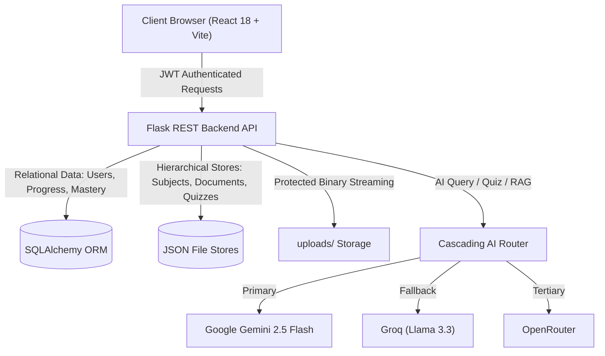

# AI Knowledge DNA — Intelligent Personalized Learning Assistant

[](#)
[](#)
[](#)
[-16A34A.svg)](#)
[](#)

**Knowledge DNA AI** is an intelligent educational assistant that bridges heterogeneous study materials with conceptual mastery. The platform ingests academic documents (PDFs, Word documents, PowerPoint presentations, and scanned/handwritten notes), extracts structured topic hierarchies, facilitates grounded retrieval-augmented generation (RAG) with verified page citations, provides an interactive voice assistant, generates difficulty-calibrated quizzes, tracks study progress, and computes a personalized Knowledge DNA composite GPA representing conceptual strengths and learning gaps.

---

## 1. System Architecture



---

## 2. Directory Structure

```text
AI-Knowledge-DNA/
├── backend/
│   ├── certs/                      # Production SSL / TiDB certificates
│   ├── data/                       # Local JSON document & quiz stores
│   ├── scripts/                    # ReportLab PDF generation utilities
│   │   ├── generate_test_cases_pdf.py
│   │   └── generate_complete_testing_report_pdf.py
│   ├── services/                   # Modular service architecture
│   │   └── ai/                     # Cascading AI router & provider integrations
│   │       ├── ai_router.py
│   │       ├── gemini_service.py
│   │       ├── groq_service.py
│   │       ├── openrouter_service.py
│   │       └── prompt_manager.py
│   ├── tests/                      # Automated unit, integration & stress suites
│   │   ├── test_base.py            # Isolated SQLite test environment
│   │   ├── test_ai_router.py
│   │   ├── test_auth_security.py
│   │   ├── test_chat_voice.py
│   │   ├── test_difficult_cases.py # 10 Difficult boundary/stress scenarios (TC_01–10)
│   │   ├── test_e2e_workflow.py
│   │   ├── test_quizzes_learning.py
│   │   ├── test_startup_config.py
│   │   └── test_subjects_documents.py
│   ├── uploads/                    # Secure uploaded materials storage
│   ├── app.py                      # Core Flask REST application & RAG engine
│   ├── models.py                   # SQLAlchemy database schemas
│   └── requirements.txt            # Python dependencies
│
├── frontend/
│   ├── public/                     # Static assets (favicons, SVG icons)
│   ├── src/
│   │   ├── components/
│   │   │   └── layout/             # Shared layout components (Navbar)
│   │   ├── context/                # React contexts (Auth, Theme, StudyTracker)
│   │   ├── features/               # Domain-specific feature modules
│   │   │   ├── authentication/     # Login & Register components
│   │   │   ├── dashboard/          # Dashboard, Weak Concepts, PersonalizedStudyPlan
│   │   │   ├── documents/          # Split PDF Viewer & AI Chat interface
│   │   │   ├── home/               # Landing page & features overview
│   │   │   ├── quiz/               # Quiz generator & interactive runner
│   │   │   ├── subjects/           # Subject & study materials manager
│   │   │   └── voice-assistant/    # Web Speech API conversational assistant
│   │   ├── services/               # Axios API client integrations
│   │   ├── App.jsx                 # Client router & authentication guards
│   │   ├── index.css               # Global theme variables & typography
│   │   └── main.jsx                # Application root entrypoint
│   ├── package.json
│   └── vite.config.js
│
├── documentation/                  # Architecture diagrams & technical specifications
├── reports/                        # Publication-ready QA deliverables
│   ├── Knowledge_DNA_AI_Test_Cases.pdf
│   └── Knowledge_DNA_AI_Complete_Testing_Report.pdf
└── README.md                       # Master project documentation
```

---

## 3. Environment Configuration

### Backend (`backend/.env`)

Create `backend/.env` with the following variables:

```env
# Flask Configuration
FLASK_ENV=development
FLASK_DEBUG=1
SECRET_KEY=replace-with-a-secure-random-secret-key
JWT_SECRET_KEY=replace-with-a-secure-jwt-secret-key

# Database Connection (Defaults to SQLite for local development)
DATABASE_URI=sqlite:///knowledge_dna.db

# AI Provider API Keys
GEMINI_API_KEY=your_gemini_api_key_here
GEMINI_MODEL=gemini-2.5-flash
GROQ_API_KEY=your_groq_api_key_here
GROQ_MODEL=llama-3.3-70b-versatile
OPENROUTER_API_KEY=your_openrouter_api_key_here
OPENROUTER_MODEL=meta-llama/llama-3.3-70b-instruct:free

# Storage Configuration
UPLOAD_FOLDER=uploads
DATA_FOLDER=data
```

### Frontend (`frontend/.env`)

```env
VITE_API_URL=http://localhost:5000/api
```

---

## 4. Setup and Installation

### Backend Setup

```powershell
# Navigate to the backend directory
cd backend

# Create and activate Python virtual environment
python -m venv venv
.\venv\Scripts\Activate.ps1

# Install required dependencies
pip install -r requirements.txt
pip install reportlab

# Initialize database tables
python create_tables.py
```

### Frontend Setup

```powershell
# Navigate to the frontend directory
cd frontend

# Install Node dependencies
npm install
```

---

## 5. Running the Application

### Development Servers

```powershell
# Terminal 1: Start Flask Backend Server (Port 5000)
cd backend
python app.py

# Terminal 2: Start Vite Frontend Dev Server (Port 5173)
cd frontend
npm run dev
```

Visit `http://localhost:5173` in your browser.

---

## 6. Testing & Quality Assurance

All test suites execute in complete data isolation using in-memory SQLite instances and isolated temporary folders, guaranteeing zero modifications to production databases or user files.

### Backend Automated Tests

```powershell
cd backend

# Run the complete test suite (55 tests)
python -m unittest discover -s tests -p "test_*.py"

# Run the 10 Difficult Stress & Boundary Test Cases (TC_01 to TC_10)
python -m unittest tests.test_difficult_cases
```

### Frontend Static Analysis & Production Build

```powershell
cd frontend

# Run ESLint static code verification
npm run lint

# Compile production-optimized client bundle
npm run build
```

---

## 7. Deliverable QA Reports

Two publication-grade PDF reports have been generated in the `reports/` folder:

1. **`reports/Knowledge_DNA_AI_Test_Cases.pdf`** (8 Pages):  
   Dedicated test cases specification covering all 10 Difficult Boundary Scenarios (TC_01 to TC_10) and 45 Core Feature Scenarios with objectives, preconditions, test data, execution steps, expected results, actual outputs, and execution logs.

2. **`reports/Knowledge_DNA_AI_Complete_Testing_Report.pdf`** (6 Pages):  
   Comprehensive 22-section quality assurance report detailing project architecture, cleanup manifest, preserved API inventory, security audits (OWASP Top 10), performance benchmarks, defect resolutions, and the Requirements Traceability Matrix.

To recompile the PDF reports from source:

```powershell
cd backend
python scripts\generate_test_cases_pdf.py
python scripts\generate_complete_testing_report_pdf.py
```

---

## 8. Dashboard Section Ordering

The dashboard UI renders strictly in the verified sequence:
1. **Welcome Section** (`.dashboard-header`)
2. **All Topics, Quiz, and Learn Streak** (`.stats-grid`)
3. **Learned Topics** (Topic cards with study duration)
4. **Upload Documents / Study Material** (Call-to-action card)
5. **My Subjects** (`<SubjectManager />`)
6. **Generate Quiz** (`<QuizGenerator />`)
7. **Weak Concepts** (Mastery bars and one-click practice quizzes)
8. **Study Plan** (`<PersonalizedStudyPlan />`)
9. **Knowledge GPA / Score** (`.knowledge-dna-preview` anchored at the bottom)

---

## 9. Security & Data Protection

- **Tenant Isolation:** All document requests and database queries filter strictly by `current_user_id` extracted from verified JWT tokens.
- **Protected PDF Streaming:** PDF files cannot be accessed directly via static paths. File retrieval uses authenticated blob endpoints (`/api/files/<filename>`) returning authenticated browser blobs to iframe canvases.
- **Prompt Injection Demarcation:** Uploaded document text is strictly encapsulated inside `--- PAGE X ---` delimiters to treat user-submitted content as passive study material.
