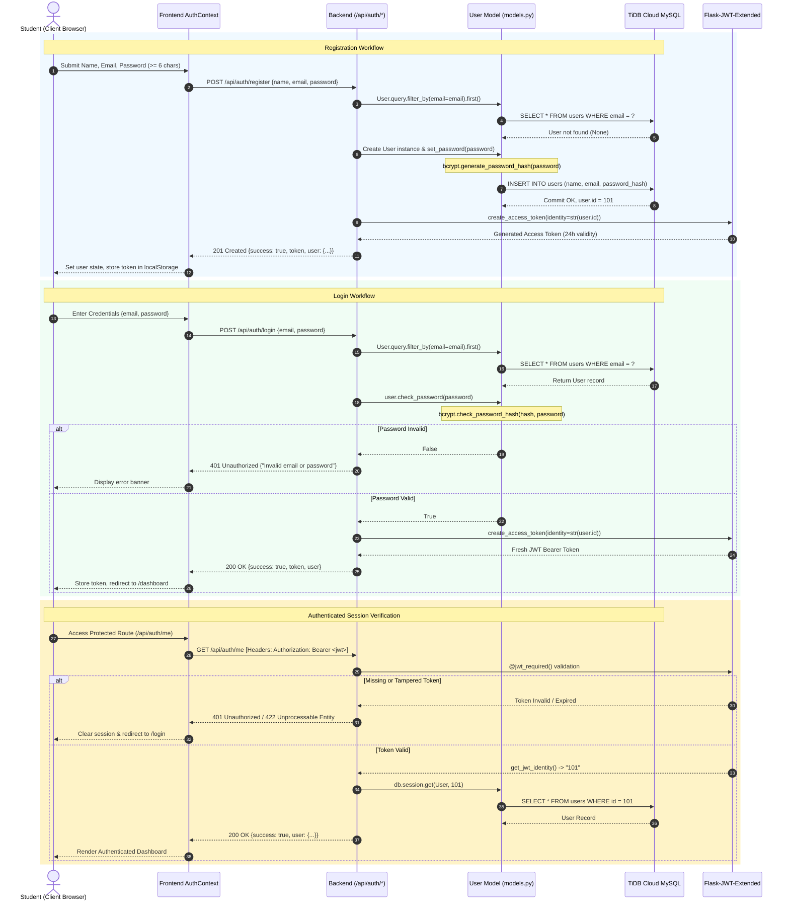

# AI Knowledge DNA — Comprehensive REST API Specification Report

**Document Code:** MCA-PRJ-DNA-004  
**Target Project:** AI Knowledge DNA – Intelligent Personalized Learning Assistant  
**Repository Path:** `E:\DNA\AI-Knowledge-DNA`  
**Classification:** REST API Contracts, Payload Schemas & Security Protocols  
**Academic Level:** Master of Computer Applications (MCA) Project Documentation  

---

## 1. Authentication & Security Architecture

The backend REST API secures all sensitive student operations through stateless JSON Web Tokens (JWT) administered by `Flask-JWT-Extended`.



### 1.1 Token Structure and Headers
- **Header:** `Authorization: Bearer <jwt_access_token>`
- **Payload Subject (`sub`):** String representation of `user.id`.
- **Expiration (`exp`):** 24 hours (`60 * 60 * 24` seconds).
- **Algorithm:** HMAC-SHA256 with key injected from `JWT_SECRET_KEY` in `backend/.env`.

---

## 2. Master REST API Endpoint Directory

Below is the verified specification for all **26 endpoints** implemented in `backend/app.py`:

### Group 1: System Status & Diagnostic Endpoints

#### 1. `GET /`
- **Access:** Public
- **Description:** Health status and platform branding verification.
- **Response (200 OK):**
  ```json
  {
    "success": true,
    "message": "AI Knowledge DNA Backend is running."
  }
  ```

#### 2. `GET /api/health`
- **Access:** Public
- **Description:** System health check and Gemini configuration report.
- **Response (200 OK):**
  ```json
  {
    "success": true,
    "status": "healthy",
    "gemini_configured": true,
    "gemini_model": "gemini-3.5-flash"
  }
  ```

---

### Group 2: User Authentication & Profile Endpoints

#### 3. `POST /api/auth/register`
- **Access:** Public
- **Request Body:**
  ```json
  {
    "name": "Alex Mercer",
    "email": "alex@university.edu",
    "password": "securePassword123"
  }
  ```
- **Responses:**
  - `201 Created`: `{ "success": true, "token": "...", "user": { "id": 1, "name": "...", "email": "..." } }`
  - `400 Bad Request`: Validation failure (name missing, email missing, password $< 6$ characters).
  - `409 Conflict`: An account with this email address already exists.

#### 4. `POST /api/auth/login`
- **Access:** Public
- **Request Body:**
  ```json
  {
    "email": "alex@university.edu",
    "password": "securePassword123"
  }
  ```
- **Responses:**
  - `200 OK`: `{ "success": true, "token": "...", "user": { ... } }`
  - `400 Bad Request`: Email or password omitted.
  - `401 Unauthorized`: Invalid email or incorrect password.

#### 5. `GET /api/auth/me`
- **Access:** Protected (`@jwt_required()`)
- **Description:** Resolves authenticated user profile from token identity.
- **Responses:**
  - `200 OK`: `{ "success": true, "user": { "id": 1, "name": "...", "email": "..." } }`
  - `401 Unauthorized`: Missing or malformed Bearer token.
  - `404 Not Found`: User record not found in database.

---

### Group 3: Subject & Folder Management Endpoints

#### 6. `POST /api/subjects`
- **Access:** Protected (`@jwt_required()`)
- **Request Body:** `{ "name": "Molecular Biology", "description": "Macromolecules" }`
- **Responses:**
  - `201 Created`: `{ "success": true, "subject": { "id": "...", "name": "...", "user_id": 1 } }`
  - `400 Bad Request`: Name is required.
  - `409 Conflict`: Subject with identical name already exists for this student.

#### 7. `GET /api/subjects`
- **Access:** Protected (`@jwt_required()`)
- **Description:** Lists all subjects belonging to the authenticated student, including document and topic counts.
- **Response (200 OK):** `{ "success": true, "subjects": [ { "id": "...", "name": "...", "document_count": 2, "topic_count": 5 } ] }`

#### 8. `GET /api/subjects/<subject_id>`
- **Access:** Protected (`@jwt_required()`)
- **Description:** Retrieves subject details and linked study documents.
- **Responses:**
  - `200 OK`: `{ "success": true, "subject": { ... }, "documents": [ ... ] }`
  - `404 Not Found`: Subject does not exist or belongs to another user.

#### 9. `DELETE /api/subjects/<subject_id>`
- **Access:** Protected (`@jwt_required()`)
- **Description:** Deletes subject, unlinks owned documents, and cascades quiz cleanup.
- **Responses:**
  - `200 OK`: `{ "success": true, "message": "Subject deleted successfully." }`
  - `404 Not Found`: Subject does not exist or unauthorized.

#### 10. `GET /api/subjects/<subject_id>/documents`
- **Access:** Protected (`@jwt_required()`)
- **Response (200 OK):** `{ "success": true, "documents": [ ... ] }`

---

### Group 4: Document Ingestion, Parsing & Streaming Endpoints

#### 11. `POST /api/upload`
- **Access:** Protected (`@jwt_required()`)
- **Content-Type:** `multipart/form-data`
- **Payload:** `file` (binary stream, max 25MB).
- **Responses:**
  - `201 Created`: `{ "success": true, "document": { "id": "...", "name": "...", "page_count": 12, "topics": [ ... ] } }`
  - `400 Bad Request`: No file provided or unsupported extension.
  - `413 Payload Too Large`: File exceeds 25 MB.
  - `500 Server Error`: Extraction engine encountered a parsing failure.

#### 12. `POST /api/upload-multiple`
- **Access:** Protected (`@jwt_required()`)
- **Content-Type:** `multipart/form-data`
- **Payload:** `files` (array of file streams).
- **Responses:**
  - `201 Created`: `{ "success": true, "documents": [ ... ], "errors": [ ... ] }`

#### 13. `GET /api/documents`
- **Access:** Protected (`@jwt_required()`)
- **Response (200 OK):** `{ "success": true, "documents": [ ... ] }`

#### 14. `GET /api/documents/<document_id>`
- **Access:** Protected (`@jwt_required()`)
- **Responses:**
  - `200 OK`: `{ "success": true, "document": { "id": "...", "pages": [ ... ], "topics": [ ... ] } }`
  - `404 Not Found`: Document not found or unauthorized.

#### 15. `DELETE /api/documents/<document_id>`
- **Access:** Protected (`@jwt_required()`)
- **Responses:**
  - `200 OK`: `{ "success": true, "message": "Document deleted successfully." }`
  - `404 Not Found`: Document not found or unauthorized.

#### 16. `GET /api/files/<filename>`
- **Access:** Protected (`@jwt_required()`)
- **Description:** Authenticated file streamer.
- **Responses:**
  - `200 OK`: Binary file stream with MIME headers (`application/pdf`, etc.).
  - `403 Forbidden`: Authenticated student does not own this file.

---

### Group 5: Grounded RAG Chat & Voice Interaction Endpoints

#### 17. `POST /api/chat`
- **Access:** Protected (`@jwt_required()`)
- **Request Body:**
  ```json
  {
    "document_id": "doc_12345",
    "question": "What is the function of ATP synthase?",
    "history": [],
    "voice_response": false
  }
  ```
- **Responses:**
  - `200 OK`: `{ "success": true, "answer": "...", "sources": [{ "page": 4 }], "model": "gemini-3.5-flash" }`
  - `400 Bad Request`: `document_id` or `question` missing.
  - `403 Forbidden`: Access denied to requested document.
  - `503 Service Unavailable`: AI service credentials unconfigured.

#### 18. `POST /api/documents/<document_id>/chat`
- **Access:** Protected (`@jwt_required()`)
- **Description:** Document-specific route alias for RAG Q&A.
- **Responses:** Identical to `/api/chat`.

---

### Group 6: Adaptive Quiz & Assessment Endpoints

#### 19. `POST /api/quiz/generate`
- **Access:** Protected (`@jwt_required()`)
- **Request Body:**
  ```json
  {
    "subject_id": "subj_123",
    "question_count": 10,
    "difficulty": "medium",
    "topic": "Cell Metabolism"
  }
  ```
- **Responses:**
  - `200 OK`: `{ "success": true, "quiz": { "id": "...", "questions": [{ "id": "q1", "question": "...", "options": [...] }] } }`
  - `400 Bad Request`: `subject_id` missing.
  - `404 Not Found`: Subject unowned or not found.
  - `503 Service Unavailable`: AI provider offline.

#### 20. `POST /api/quiz/<quiz_id>/submit`
- **Access:** Protected (`@jwt_required()`)
- **Request Body:** `{ "answers": { "q1": 1, "q2": 0 } }`
- **Responses:**
  - `200 OK`: `{ "success": true, "score": 2, "total": 2, "accuracy": 100.0, "results": [ ... ] }`
  - `404 Not Found`: Quiz not found or unowned.

#### 21. `GET /api/quizzes`
- **Access:** Protected (`@jwt_required()`)
- **Response (200 OK):** `{ "success": true, "quizzes": [ ... ] }`

---

### Group 7: Learning Analytics & Personalized Study Plan Endpoints

#### 22. `POST /api/learning/session`
- **Access:** Protected (`@jwt_required()`)
- **Request Body:** `{ "topic": "Cell Biology", "study_minutes": 45 }`
- **Responses:**
  - `201 Created`: `{ "success": true, "progress": { ... }, "study_hours": 0.8, "learning_streak": 3 }`
  - `400 Bad Request`: `study_minutes` outside range 1–720.

#### 23. `GET /api/learning/progress`
- **Access:** Protected (`@jwt_required()`)
- **Response (200 OK):** `{ "success": true, "progress": [ ... ], "subjects": [ ... ], "study_hours": 4.5, "learning_streak": 5 }`

#### 24. `GET /api/learning/insights`
- **Access:** Protected (`@jwt_required()`)
- **Description:** Generates personalized study plan with prioritized weak topics and reference materials.
- **Response (200 OK):** `{ "success": true, "plan": { "items": [ ... ], "total_minutes": 90 } }`

#### 25. `GET /api/dashboard/stats`
- **Access:** Protected (`@jwt_required()`)
- **Response (200 OK):**
  ```json
  {
    "success": true,
    "stats": {
      "knowledge_dna": 84.5,
      "topics_learned": 14,
      "quiz_accuracy": 92.0,
      "learning_streak": 4,
      "study_hours": 6.5,
      "study_minutes": 390
    }
  }
  ```

---

## 3. Standardized Error Payload Architecture

All endpoint errors conform to a unified JSON contract:

```json
{
  "success": false,
  "message": "Human-readable description of error.",
  "error": "Error name or diagnostic token"
}
```

The error mapping rules ensure:
- HTTP 400: Malformed syntax or schema validation error.
- HTTP 401: Missing or invalid JWT Authorization header.
- HTTP 403: Ownership or tenant boundary violation.
- HTTP 404: Target entity not found for current authenticated tenant.
- HTTP 409: Unique key conflict (e.g. duplicate email, duplicate subject name).
- HTTP 413: Upload size exceeds 25 MB payload limit.
- HTTP 500: Internal server error with database rollback.
- HTTP 503: AI Provider service unavailable or unconfigured.
