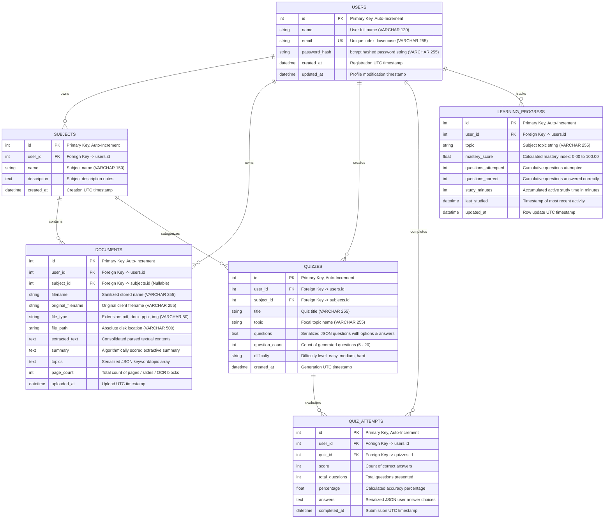

# AI Knowledge DNA — Database Design & Schema Specification Report

**Document Code:** MCA-PRJ-DNA-003  
**Target Project:** AI Knowledge DNA – Intelligent Personalized Learning Assistant  
**Repository Path:** `E:\DNA\AI-Knowledge-DNA`  
**Classification:** Database Architecture, Relational Schema & Storage Engine Report  
**Academic Level:** Master of Computer Applications (MCA) Project Documentation  

---

## 1. Relational Schema & Entity-Relationship Model

The AI Knowledge DNA application employs an ACID-compliant relational data model specified via SQLAlchemy ORM in `backend/models.py`.



---

## 2. Comprehensive Relational Data Dictionaries

### 2.1 Table: `users`
Stores student accounts, credential hashes, and lifecycle timestamps.

| Column Name | SQL Type | Constraints | Default | Description |
| :--- | :--- | :--- | :--- | :--- |
| `id` | `INTEGER` | Primary Key, Auto-Increment | — | Unique internal user identifier. |
| `name` | `VARCHAR(120)` | `NOT NULL` | — | Student display name. |
| `email` | `VARCHAR(255)` | `NOT NULL`, `UNIQUE`, Index | — | Normalized, lowercased student email address. |
| `password_hash`| `VARCHAR(255)` | `NOT NULL` | — | bcrypt password hash digest. |
| `created_at` | `DATETIME` | `NOT NULL` | `utcnow` | Account registration UTC timestamp. |
| `updated_at` | `DATETIME` | `NOT NULL` | `utcnow` | Last credential or profile update timestamp. |

### 2.2 Table: `subjects`
Organizes learning folders and academic domains created by users.

| Column Name | SQL Type | Constraints | Default | Description |
| :--- | :--- | :--- | :--- | :--- |
| `id` | `INTEGER` | Primary Key, Auto-Increment | — | Unique subject record identifier. |
| `user_id` | `INTEGER` | Foreign Key (`users.id`), Index | — | Multi-tenant user ownership reference. |
| `name` | `VARCHAR(150)` | `NOT NULL` | — | Subject title (e.g., "Cell Biology"). |
| `description` | `TEXT` | Nullable | `NULL` | Detailed scope or syllabus outline. |
| `created_at` | `DATETIME` | `NOT NULL` | `utcnow` | Creation UTC timestamp. |

### 2.3 Table: `documents`
Catalogs study materials, physical disk references, and parsed extraction structures.

| Column Name | SQL Type | Constraints | Default | Description |
| :--- | :--- | :--- | :--- | :--- |
| `id` | `INTEGER` | Primary Key, Auto-Increment | — | Unique document record identifier. |
| `user_id` | `INTEGER` | Foreign Key (`users.id`), Index | — | Document owner identifier. |
| `subject_id` | `INTEGER` | Foreign Key (`subjects.id`), Index | `NULL` | Associated subject grouping (nullable). |
| `filename` | `VARCHAR(255)` | Nullable | `NULL` | Storage filename (`<uuid>.<ext>`). |
| `original_filename`| `VARCHAR(255)` | Nullable | `NULL` | Client-provided original filename. |
| `file_type` | `VARCHAR(50)` | Nullable | `NULL` | Lowercase extension (`pdf`, `docx`, etc.). |
| `file_path` | `VARCHAR(500)` | Nullable | `NULL` | Absolute path on server file system. |
| `extracted_text` | `TEXT` | Nullable | `NULL` | Full consolidated text extracted from file. |
| `summary` | `TEXT` | Nullable | `NULL` | Extractive summary generated on ingestion. |
| `topics` | `TEXT` | Nullable | `NULL` | Serialized JSON array of discovered topics. |
| `page_count` | `INTEGER` | `NOT NULL` | `0` | Total count of extracted pages or slides. |
| `uploaded_at` | `DATETIME` | `NOT NULL` | `utcnow` | Ingestion timestamp. |

### 2.4 Table: `quizzes`
Stores generated adaptive assessments.

| Column Name | SQL Type | Constraints | Default | Description |
| :--- | :--- | :--- | :--- | :--- |
| `id` | `INTEGER` | Primary Key, Auto-Increment | — | Unique quiz identifier. |
| `user_id` | `INTEGER` | Foreign Key (`users.id`), Index | — | Owner user identifier. |
| `subject_id` | `INTEGER` | Foreign Key (`subjects.id`), Index | `NULL` | Related subject identifier. |
| `title` | `VARCHAR(255)` | `NOT NULL` | — | Quiz title banner. |
| `topic` | `VARCHAR(255)` | Nullable | `NULL` | Topic scope of assessment. |
| `questions` | `TEXT` | `NOT NULL` | — | Serialized JSON array of questions, options, answers. |
| `question_count`| `INTEGER` | `NOT NULL` | `0` | Question quantity (bounded 5–20). |
| `difficulty` | `VARCHAR(50)` | `NOT NULL` | `"medium"` | Assessment difficulty (`easy`, `medium`, `hard`). |
| `created_at` | `DATETIME` | `NOT NULL` | `utcnow` | Generation UTC timestamp. |

### 2.5 Table: `quiz_attempts`
Logs completed quiz submissions.

| Column Name | SQL Type | Constraints | Default | Description |
| :--- | :--- | :--- | :--- | :--- |
| `id` | `INTEGER` | Primary Key, Auto-Increment | — | Unique attempt record identifier. |
| `user_id` | `INTEGER` | Foreign Key (`users.id`), Index | — | Student identifier. |
| `quiz_id` | `INTEGER` | Foreign Key (`quizzes.id`), Index | — | Target quiz identifier. |
| `score` | `INTEGER` | `NOT NULL` | `0` | Raw count of correct answers. |
| `total_questions`| `INTEGER` | `NOT NULL` | `0` | Total questions attempted. |
| `percentage` | `FLOAT` | `NOT NULL` | `0.0` | Accuracy percentage (`score / total * 100`). |
| `answers` | `TEXT` | Nullable | `NULL` | Serialized JSON student answer index selections. |
| `completed_at` | `DATETIME` | `NOT NULL` | `utcnow` | Submission timestamp. |

### 2.6 Table: `learning_progress`
Maintains cumulative topic mastery, study duration, and consistency indicators.

| Column Name | SQL Type | Constraints | Default | Description |
| :--- | :--- | :--- | :--- | :--- |
| `id` | `INTEGER` | Primary Key, Auto-Increment | — | Unique progress row identifier. |
| `user_id` | `INTEGER` | Foreign Key (`users.id`), Index | — | Student identifier. |
| `topic` | `VARCHAR(255)` | `NOT NULL` | — | Distinct learning topic (e.g., "Active Transport"). |
| `mastery_score` | `FLOAT` | `NOT NULL` | `0.0` | Calculated mastery percentage (0.00 – 100.00). |
| `questions_attempted`| `INTEGER` | `NOT NULL` | `0` | Cumulative questions attempted on topic. |
| `questions_correct`| `INTEGER` | `NOT NULL` | `0` | Cumulative questions answered correctly. |
| `study_minutes` | `INTEGER` | `NOT NULL` | `0` | Accumulated study minutes logged on topic. |
| `last_studied` | `DATETIME` | Nullable | `NULL` | Timestamp of most recent study session or quiz. |
| `updated_at` | `DATETIME` | `NOT NULL` | `utcnow` | Entity update timestamp. |

---

## 3. Dual-Storage Hybrid Architecture

The application implements a hybrid persistence strategy designed for academic high-performance deployments:

1. **Relational Database (TiDB Cloud MySQL):**
   - Handles ACID transactions, user authentication, relational integrity, foreign key cascading, and cumulative aggregate analytics (`LearningProgress`).
   - Connected via TLS 1.2/1.3 with CA certification, connection health pre-pinging (`pool_pre_ping: True`), and connection pool recycling.
2. **Atomic JSON Flat-File Stores (`backend/data/`):**
   - `documents.json`: Stores rich page-level extracted text chunks, topic structures, and summarization artifacts. Allows rapid JSON in-memory filtering by user without serializing megabyte-scale text fields across database socket connections.
   - `subjects.json`: Provides immediate metadata lookups for UI folder views.
   - `quizzes.json`: Holds full assessment structures and submission histories.
3. **Synchronization & Isolation Protocol:**
   - Every JSON record carries a mandatory `user_id` attribute.
   - The helper function `_same_user(record_user_id, current_user_id)` enforces strict multi-tenant boundaries prior to returning or mutating data.

---

## 4. Database Security & Connection Hardening

- **Credential Hashing:** Passwords are never stored in plaintext. They are encrypted using `werkzeug.security.generate_password_hash` with bcrypt salt iterations.
- **Connection Parameters:**
  ```python
  app.config["SQLALCHEMY_ENGINE_OPTIONS"] = {
      "pool_pre_ping": True,
      "connect_args": {
          "ssl": {
              "ca": DB_SSL_CA
          }
      }
  }
  ```
- **Transaction Rollbacks:** Every database mutation route wraps transactions in `try...except` blocks with automatic `db.session.rollback()` on failure to prevent stale connection pool locks.
