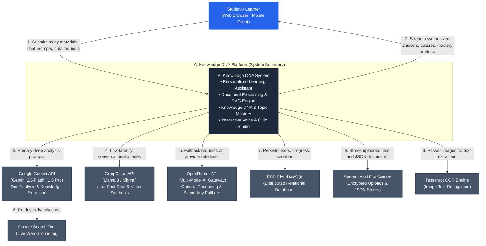
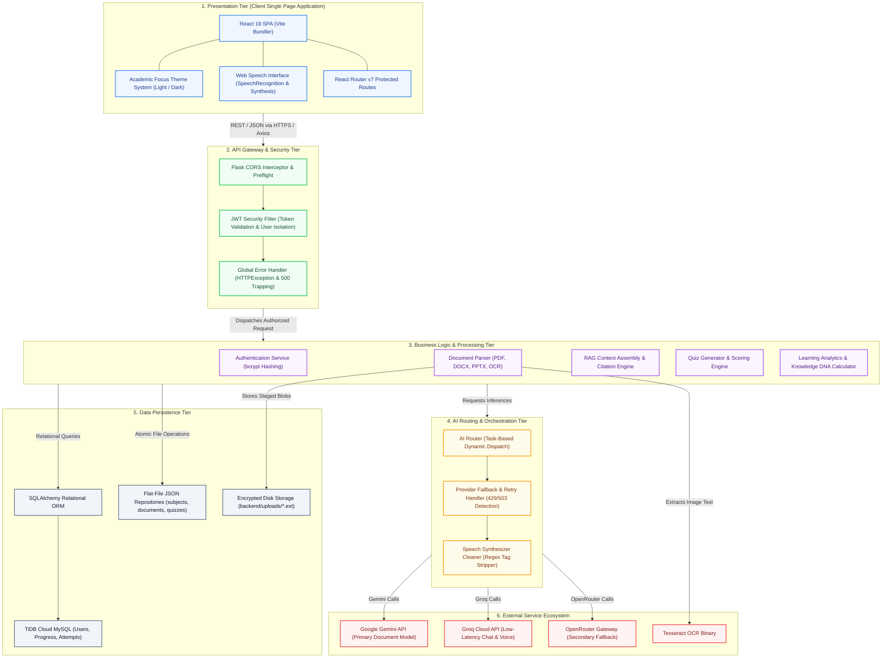
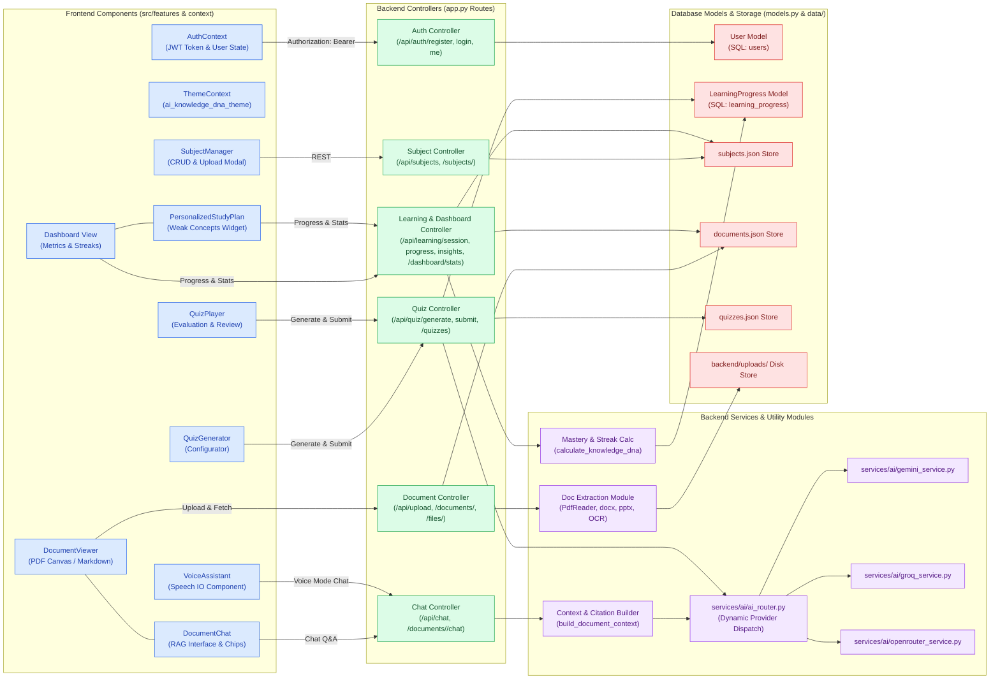
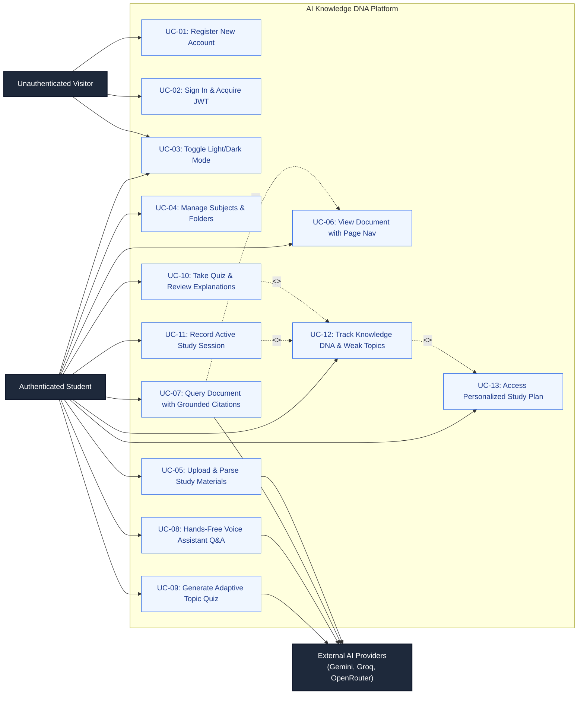
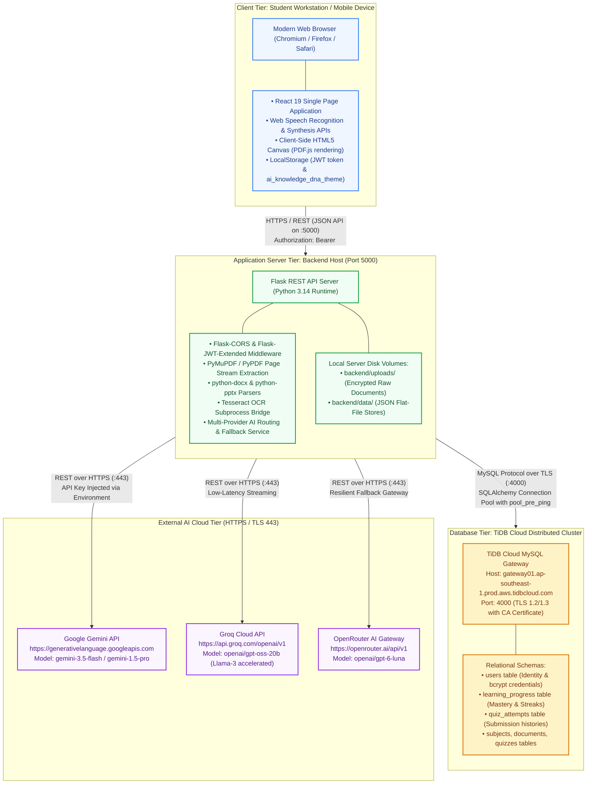
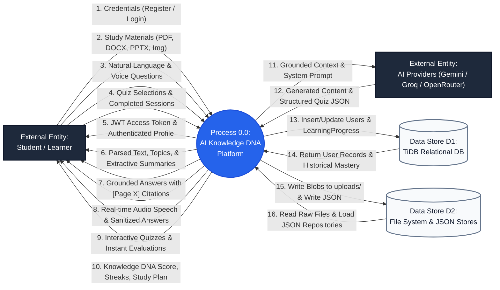
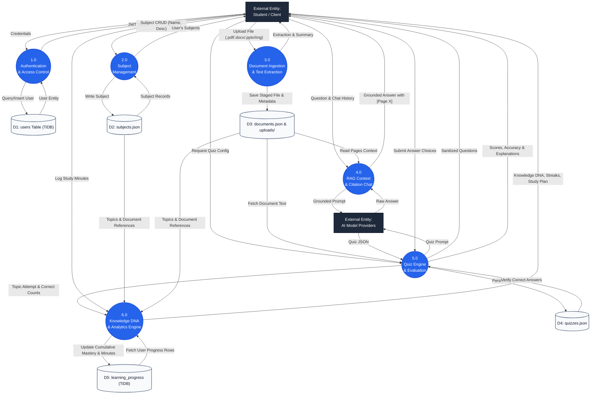

# AI Knowledge DNA — System Architecture & Design Specification Report

**Document Code:** MCA-PRJ-DNA-001  
**Target Project:** AI Knowledge DNA – Intelligent Personalized Learning Assistant  
**Repository Path:** `E:\DNA\AI-Knowledge-DNA`  
**Classification:** Technical Architecture & System Design Report  
**Academic Level:** Master of Computer Applications (MCA) Project Documentation  

---

## Abstract

This technical report presents the comprehensive architectural specification of the **AI Knowledge DNA** platform. The system is an intelligent, personalized educational assistant engineered to bridge academic study materials, generative artificial intelligence, and adaptive knowledge modeling. The architecture incorporates a decoupled single-page application frontend built with React 19, a RESTful micro-service backend powered by Flask and SQLAlchemy, a hybrid persistence tier utilizing distributed TiDB Cloud MySQL alongside atomic flat-file stores, and an AI routing orchestration layer that dynamically balances requests across Google Gemini, Groq Cloud, and OpenRouter with automatic failover circuits.

---

## 1. System Context & Operational Boundaries

The system context diagram delineates the operational boundaries of the AI Knowledge DNA system, detailing the interactions between the primary student persona, client user interfaces, internal core subsystems, and external specialized service providers.

### 1.1 Boundary Entities Description

1. **Student / Learner Persona:** Interacts with the platform via modern web browsers on desktop and mobile viewports. Utilizes document upload features, reads extracted texts with synchronized page navigation, queries the RAG conversational agent, engages in hands-free voice sessions, takes diagnostic quizzes, and reviews personalized study recommendations.
2. **AI Provider Ecosystem:**
   - **Google Gemini API (`gemini-3.5-flash`):** Primary engine for deep document parsing, complex prompt ingestion, structured JSON quiz synthesis, and grounded answering.
   - **Groq Cloud API (`openai/gpt-oss-20b`):** Hardware-accelerated inference engine utilized for low-latency conversational queries and real-time voice assistant speech synthesis.
   - **OpenRouter API (`openai/gpt-6-luna`):** Unified secondary fallback gateway invoked when primary providers experience transient HTTP 429 rate limits or HTTP 503 service outages.
3. **Storage & Infrastructure:**
   - **TiDB Cloud MySQL:** High-availability distributed database cluster hosting normalized user identity records, authentication credentials, and cumulative `LearningProgress` metrics.
   - **Local File System Storage:** Staged raw binary files in `backend/uploads/` and structured entity catalogs in `backend/data/`.
   - **Tesseract OCR Subprocess:** Local optical character recognition binary invoked dynamically for image-based study materials (`.png`, `.jpg`, `.jpeg`, `.webp`).

---

## 2. High-Level Multi-Tier Architectural Topology

The AI Knowledge DNA application is structured into five distinct architectural tiers following strict separation of concerns and loose coupling principles.

### 2.1 Tier Breakdown and Responsibilities

| Tier | Primary Technologies | Core Responsibilities |
| :--- | :--- | :--- |
| **Presentation Tier** | React 19, Vite, React Router v7, Framer Motion, Web Speech API | Client-side routing, state management, responsive UI rendering, PDF canvas display, speech I/O, and theme synchronization. |
| **API Gateway Tier** | Flask, Flask-CORS, Flask-JWT-Extended, Werkzeug Exceptions | Endpoint routing, CORS preflight handling, JWT signature and expiration verification, client input sanitization, and HTTP error code preservation. |
| **Service Tier** | Python 3.14, pypdf, python-docx, python-pptx, PIL, pytesseract | Document text extraction, keyword extraction, context window truncation, extractive summarization, anti-cheat quiz generation, and Knowledge DNA metric computation. |
| **AI Orchestration Tier** | `ai_router.py`, `gemini_service.py`, `groq_service.py`, `openrouter_service.py` | Task-to-provider dispatching, exponential backoff retries, transient error detection (HTTP 429/503), multi-provider failover, and voice response sanitization. |
| **Persistence Tier** | SQLAlchemy, PyMySQL, TiDB Cloud, JSON storage, Local disk storage | ACID-compliant user identity storage, cumulative topic progress tracking, atomic JSON catalog persistence, and disk file stream management. |

---

## 3. Component Architecture & Subsystem Decomposition

The component architecture defines the concrete classes, controllers, contexts, and modules comprising the codebase:

---

## 4. Functional Boundary & Use-Case Model

The use-case model specifies all actor-to-system interactions across the platform boundary:

---

## 5. Physical and Logical Deployment Model

---

## 6. Data-Flow Modeling (Level 0 Context Diagram)

---

## 7. Data-Flow Modeling (Level 1 Functional Decomposition)

---

## 8. Architectural Integrity and Verification Summary

1. **Multi-Tenant User Isolation:** Every data access routine (`filter_documents_for_user`, `filter_subjects_for_user`, `filter_quizzes_for_user`) inspects the authenticated JWT token identity (`get_jwt_identity()`). Users cannot query or mutate peer records.
2. **File Descriptor Resilience:** All file system read operations use context managers (`with open(...)`), eliminating `[WinError 32]` file handle locks under Windows execution environments.
3. **HTTP Contract Preservation:** The global exception handler traps `werkzeug.exceptions.HTTPException` to preserve standard 400, 401, 403, 404, 405, 409, and 413 HTTP status codes.
