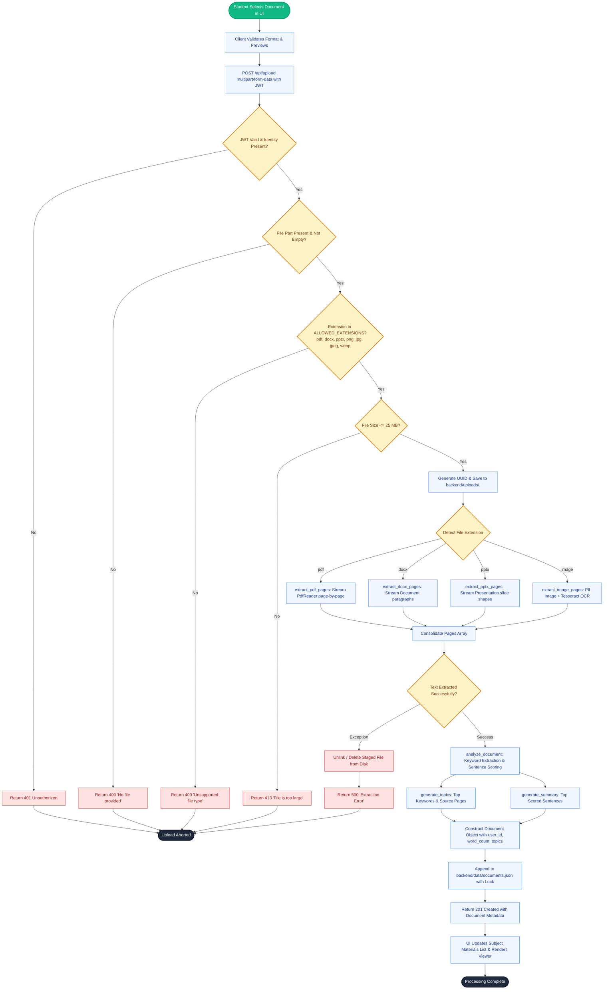
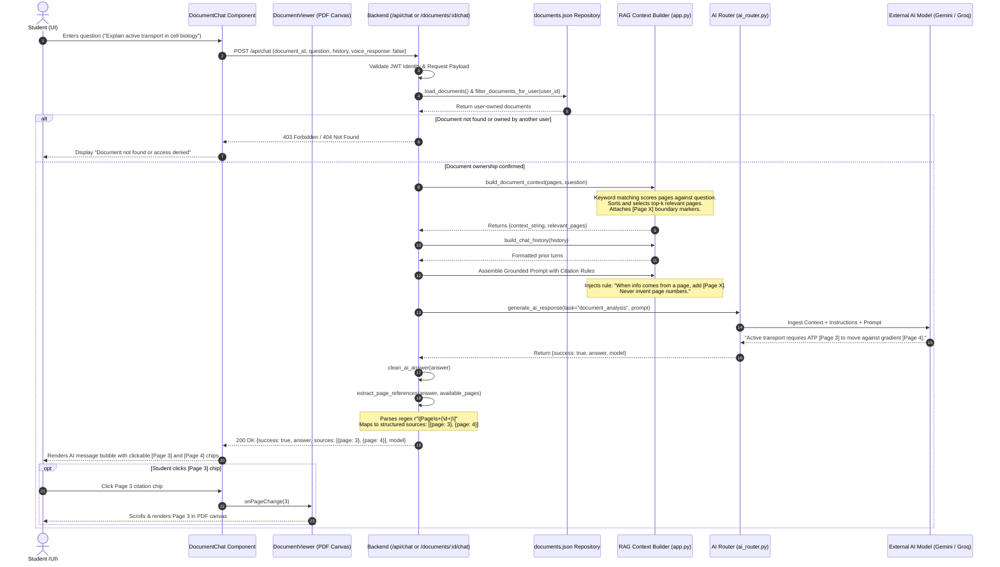
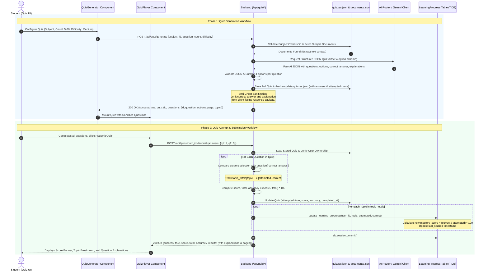
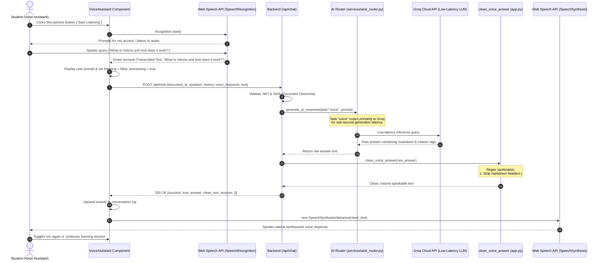
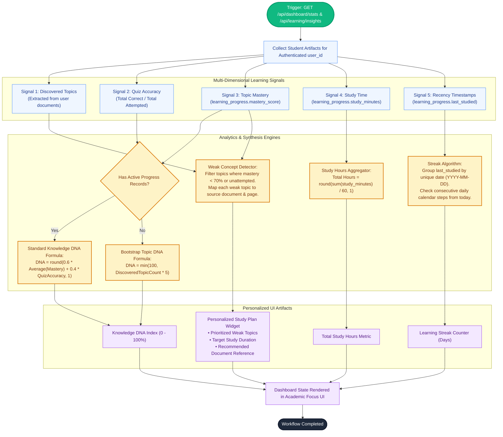

# AI Knowledge DNA — Workflows, Algorithms & AI Orchestration Report

**Document Code:** MCA-PRJ-DNA-002  
**Target Project:** AI Knowledge DNA – Intelligent Personalized Learning Assistant  
**Repository Path:** `E:\DNA\AI-Knowledge-DNA`  
**Classification:** Engineering Workflows, Mathematical Formulations & Algorithm Specifications  
**Academic Level:** Master of Computer Applications (MCA) Project Documentation  

---

## 1. Document Upload & Multi-Format Ingestion Pipeline

The document ingestion pipeline processes diverse file formats (PDF, DOCX, PPTX, Images), extracts textual contents, runs extractive text analysis, and indexes topics.



### 1.1 Text Extraction and Sentence Scoring Algorithm

Extractive summarization operates deterministically without relying on high-latency AI calls, ensuring offline capability:

1. **Keyword Extraction:** Identifies significant terms ($W$) exceeding length 3 while filtering standard stop words:
   $$\text{Frequency}(w) = \sum_{p \in P} \text{count}(w, p.text)$$
2. **Sentence Relevance Scoring:** For each sentence $s \in S$, its informational weight $R(s)$ is the sum of keyword occurrences normalized by sentence length:
   $$R(s) = \sum_{w \in W_{\text{top}}} \text{count}(w, s)$$
3. **Summary Generation:** The top 3 ranked sentences meeting minimal length requirements ($> 30$ characters) are combined chronologically to form the document executive summary.

---

## 2. Grounded Document RAG Q&A & Citation Extraction

The Retrieval-Augmented Generation (RAG) subsystem enables students to ask questions against their uploaded materials, receiving answers grounded with verifiable page citations.



### 2.1 Context Assembly and Citation Rules

- **Relevance Ranking:** Page chunks are scored against student question tokens:
  $$\text{PageScore}(P_i, Q) = \sum_{q \in Q} \text{TermFrequency}(q, P_i)$$
- **Strict Citation Policy:** The system prompt enforces:
  1. Primary source restriction: Information must be extracted from the supplied context.
  2. Grounding references: Information derived from a specific page must be annotated with `[Page X]`.
  3. Anti-hallucination guard: If an answer is not present in the study materials, the model explicitly notifies the student rather than extrapolating.

---

## 3. AI Provider Routing & Resilient Fallback Circuits

The AI orchestration engine in `backend/services/ai/ai_router.py` provides resilient multi-provider dispatch:

```mermaid
flowchart TD
    classDef startNode fill:#10B981,stroke:#059669,color:#FFFFFF,stroke-width:2px;
    classDef actionNode fill:#EFF6FF,stroke:#3B82F6,color:#1E3A8A,stroke-width:1px;
    classDef decisionNode fill:#FEF3C7,stroke:#D97706,color:#78350F,stroke-width:2px;
    classDef errorNode fill:#FEE2E2,stroke:#DC2626,color:#991B1B,stroke-width:1px;
    classDef endNode fill:#1E293B,stroke:#0F172A,color:#FFFFFF,stroke-width:2px;

    Start([Call generate_ai_response]):::startNode --> ValidateInput{Validate Task & Prompt?}:::decisionNode

    ValidateInput -- Empty / Invalid --> RaiseValueError[Raise ValueError 'Task/Prompt Required']:::errorNode --> Abort([Execution Terminated]):::endNode
    ValidateInput -- Valid --> CheckExplicitProvider{Explicit Provider Specified?}:::decisionNode

    CheckExplicitProvider -- Yes --> UseExplicit[Selected = Explicit Provider]:::actionNode
    CheckExplicitProvider -- No --> TaskLookup[Lookup TASK_PROVIDER_MAP by Task]:::actionNode

    TaskLookup --> BranchTask{Classify Task}:::decisionNode
    BranchTask -- document_analysis / summary / embedding --> MapGemini[Primary = Gemini]:::actionNode
    BranchTask -- chat / voice / fast_response / quick_quiz --> MapGroq[Primary = Groq]:::actionNode
    BranchTask -- general / model_testing --> MapOpenRouter[Primary = OpenRouter]:::actionNode

    UseExplicit & MapGemini & MapGroq & MapOpenRouter --> ResolveSequence[Resolve Sequence from FALLBACK_ORDER]:::actionNode

    ResolveSequence --> SeqNote["Gemini: [Gemini -> OpenRouter -> Groq]<br/>Groq: [Groq -> OpenRouter -> Gemini]<br/>OpenRouter: [OpenRouter -> Groq -> Gemini]"]:::actionNode

    SeqNote --> InitLoop[Index = 0; FallbackUsed = False]:::actionNode
    InitLoop --> ExecProvider[Execute _generate_with_provider for Current Provider]:::actionNode

    ExecProvider --> CheckCallSuccess{API Call Successful?}:::decisionNode

    CheckCallSuccess -- Yes --> LogSuccess[Log Response Time & Model Metadata]:::actionNode
    LogSuccess --> ReturnPayload[Return {success: True, provider, model, answer, fallback_used}]:::actionNode
    ReturnPayload --> EndSuccess([Return Response]):::endNode

    CheckCallSuccess -- Caught Exception --> CheckTempErr{is_temporary_error?<br/>429, rate limit, quota, timeout, 500, 502, 503, overloaded}:::decisionNode

    CheckTempErr -- No Permanent Error<br/>e.g. Auth/Invalid Key --> RaisePermanent[Raise Exception Immediately<br/>Do Not Cascade Fallback]:::errorNode --> Abort

    CheckTempErr -- Yes Transient Error --> CheckHasNext{Next Provider Available in Sequence?}:::decisionNode

    CheckHasNext -- Yes --> TriggerFallback[Set FallbackUsed = True<br/>Index = Index + 1<br/>Log Fallback Warning]:::actionNode
    TriggerFallback --> ExecProvider

    CheckHasNext -- No Exhausted --> RaiseAllFailed[Raise RuntimeError 'All AI providers failed']:::errorNode --> Abort
```

### 3.1 Task Mapping & Fallback Table

| Task Category | Primary Provider | Fallback Sequence | Target Model | Optimization Goal |
| :--- | :--- | :--- | :--- | :--- |
| `document_analysis` | **Gemini** | Gemini $\to$ OpenRouter $\to$ Groq | `gemini-3.5-flash` | Large token context, dense reasoning |
| `summary` | **Gemini** | Gemini $\to$ OpenRouter $\to$ Groq | `gemini-3.5-flash` | Comprehensive document compression |
| `chat` | **Groq** | Groq $\to$ OpenRouter $\to$ Gemini | `openai/gpt-oss-20b` | High throughput, conversational fluency |
| `voice` | **Groq** | Groq $\to$ OpenRouter $\to$ Gemini | `openai/gpt-oss-20b` | Minimal latency ($< 800\text{ms}$ time-to-first-token) |
| `quick_quiz` | **Groq** | Groq $\to$ OpenRouter $\to$ Gemini | `openai/gpt-oss-20b` | Rapid multi-choice extraction |
| `general` | **OpenRouter** | OpenRouter $\to$ Groq $\to$ Gemini | `openai/gpt-6-luna` | Broad pedagogical explanations |

---

## 4. Adaptive Quiz Generation & Anti-Cheat Evaluation

The quiz subsystem generates customized assessments and evaluates attempts:



---

## 5. Learning Progress Accumulation & Streak Algorithms

```mermaid
flowchart TD
    classDef startNode fill:#10B981,stroke:#059669,color:#FFFFFF,stroke-width:2px;
    classDef actionNode fill:#EFF6FF,stroke:#3B82F6,color:#1E3A8A,stroke-width:1px;
    classDef decisionNode fill:#FEF3C7,stroke:#D97706,color:#78350F,stroke-width:2px;
    classDef errorNode fill:#FEE2E2,stroke:#DC2626,color:#991B1B,stroke-width:1px;
    classDef endNode fill:#1E293B,stroke:#0F172A,color:#FFFFFF,stroke-width:2px;

    StartA([Event A: Study Session Completed]):::startNode --> InputMinutes[Payload: topic, study_minutes]:::actionNode
    StartB([Event B: Quiz Attempt Submitted]):::startNode --> InputQuiz[Payload: topic_totals with questions attempted & correct]:::actionNode

    InputMinutes --> CheckMinutes{Minutes between 1 and 720?}:::decisionNode
    CheckMinutes -- No --> RejectMinutes[Return 400 'Invalid study_minutes']:::errorNode --> EndFailure([Aborted]):::endNode
    CheckMinutes -- Yes --> FetchUser[Extract Authenticated user_id from JWT]:::actionNode

    InputQuiz --> FetchUser

    FetchUser --> QueryDB[Query LearningProgress for user_id and topic in TiDB]:::actionNode
    QueryDB --> CheckRowExists{Record Exists for Topic?}:::decisionNode

    CheckRowExists -- No --> CreateRow[Instantiate new LearningProgress record<br/>defaults: attempted=0, correct=0, minutes=0]:::actionNode
    CheckRowExists -- Yes --> LoadRow[Load existing LearningProgress entity]:::actionNode

    CreateRow & LoadRow --> AccumulateStats[Accumulate Metrics:<br/>study_minutes += new_minutes<br/>questions_attempted += new_attempted<br/>questions_correct += new_correct]:::actionNode

    AccumulateStats --> CalcMastery{questions_attempted > 0?}:::decisionNode
    CalcMastery -- Yes --> ComputeMastery[mastery_score = round((correct / attempted) * 100, 2)]:::actionNode
    CalcMastery -- No --> KeepMastery[Preserve existing mastery_score]:::actionNode

    ComputeMastery & KeepMastery --> UpdateTimestamp[Update last_studied = current UTC timestamp]:::actionNode
    UpdateTimestamp --> CommitDB[Execute db.session.commit() to TiDB Cloud]:::actionNode

    CommitDB --> LoadAllUserRows[Fetch all progress rows for user_id]:::actionNode
    LoadAllUserRows --> CalcStreak[calculate_learning_streak: Count consecutive active study dates]:::actionNode
    LoadAllUserRows --> CalcHours[Total Study Hours = sum(study_minutes) / 60]:::actionNode
    LoadAllUserRows --> CalcDNA["calculate_knowledge_dna:<br/>Score = 0.6 * avg(mastery) + 0.4 * quiz_accuracy"]:::actionNode

    CalcStreak & CalcHours & CalcDNA --> ReturnResponse[Return 200/201 JSON with progress, study_hours, streak, DNA score]:::actionNode
    ReturnResponse --> UpdateUI[Dashboard & Personalized Study Plan Refresh UI]:::actionNode
    UpdateUI --> EndSuccess([Learning Progress Synchronized]):::endNode
```

### 5.1 Mastery and Streak Formulations

1. **Topic Mastery Score:**
   $$\text{Mastery}(T) = \begin{cases} \text{round}\left(\frac{\sum \text{QuestionsCorrect}(T)}{\sum \text{QuestionsAttempted}(T)} \times 100, 2\right), & \text{if } \text{Attempted} > 0 \\ 0.00, & \text{otherwise} \end{cases}$$
2. **Learning Streak Algorithm:**
   Let $D = \{ \text{date}(\text{last\_studied}_i) \mid \text{last\_studied}_i \neq \text{NULL} \}$ sorted in descending order.
   Starting from current date $d_0 = \text{today}$:
   $$\text{Streak} = \max \{ k \mid \forall j \in [0, k-1], \, (d_0 - j \text{ days}) \in D \}$$

---

## 6. Voice Assistant Speech Processing Pipeline



---

## 7. Knowledge DNA Processing & Study Plan Synthesis



### 7.1 Mathematical Knowledge DNA Formulation

The Knowledge DNA index ($K_{\text{DNA}} \in [0, 100]$) serves as the student's unified mastery score:

$$K_{\text{DNA}} = \begin{cases} 
\text{round}\left(0.6 \cdot \bar{M} + 0.4 \cdot A_Q, \, 1\right), & \text{if } |\mathcal{T}_{\text{evaluated}}| > 0 \\ 
\min\left(100, \, |\mathcal{T}_{\text{discovered}}| \cdot 5\right), & \text{if } |\mathcal{T}_{\text{evaluated}}| = 0 \text{ and } |\mathcal{T}_{\text{discovered}}| > 0 \\ 
0.0, & \text{otherwise} 
\end{cases}$$

Where:
- $\bar{M} = \frac{1}{|\mathcal{T}_{\text{evaluated}}|} \sum_{t \in \mathcal{T}} \text{Mastery}(t)$ is the mean topic mastery score.
- $A_Q = \frac{\sum \text{Correct}}{\sum \text{TotalQuestions}} \times 100$ is the cumulative quiz accuracy across all attempts.
- $|\mathcal{T}_{\text{discovered}}|$ represents unique topics extracted across the student's study materials.
